# TenantHub

> A multi-tenant back-office for small service businesses, built on the SaaS foundation most B2B products need:
> isolated tenants, real permissions, invitations, plan limits and an audit trail that cannot be edited. In v2, the
> businesses' own customers can sign in too, and the database proves they see only their own work.


TenantHub lets a cleaning company, a landscaper or a small agency sign up as an organization, invite its team, keep
its clients, and plan and track jobs. Every change is recorded. The product is deliberately ordinary. What it
demonstrates is the part that is hard to get right and expensive to fix later: **one customer can never see or touch
another customer's data**, and the code proves it with tests that cover new features automatically.

It is a portfolio project. All organizations, people and data in it are fictional.

## What's new in v2

- **Recurring agreements** generate the visits ("every Monday and Thursday", "the last Friday of the month") in each
  organization's time zone, sixty days ahead, without ever creating one twice.
- **A dispatch board:** who goes where this week. Drag a card, or use "Move to…" from the keyboard; every move is
  announced, and a conflicting move is refused rather than lost.
- **A client portal:** a business's clients sign in with an emailed link to see their visits, approve quotes, ask for
  work and sign off completed visits. A second kind of identity, with its own boundary inside the organization.
- **Completion proof:** checklists that must be ticked before a job completes, and photos that are re-encoded and
  stripped of location data on upload.
- **Notifications** in the app and by email, from a transactional outbox that several instances can run safely.
- **An API and signed webhooks** for other tools, with hashed keys and a guard against requests to private addresses.
- **Row-level security:** PostgreSQL itself now refuses another organization's rows, and another client's rows in a
  portal session, even if every check in the application failed.

## Try it

With Docker running, from a fresh clone:

```
cp .env.example .env
docker compose up --build --wait
```

Open http://localhost:8080. The stack is the production image with PostgreSQL and a local mail catcher, and it starts
with demo data: **Brightline Cleaning Co.** (Team plan: 40 clients, 150 jobs over four months plus the visits of
three recurring agreements, photos, and three clients with a portal contact) and **Harbor & Pine Landscaping** (Free
plan, at its limits).

Sign in with the `DEMO_PASSWORD` from `.env` (`Change-Me-Demo-2026!` unless you change it) as:

| Who | Role | What they see |
|---|---|---|
| `olivia@brightline.example` | Owner | everything, including the plan and deleting the organization |
| `adam@brightline.example` | Admin | the team, clients, jobs, the board, agreements, requests, settings and the audit log |
| `maya@brightline.example` | Member | clients and jobs; works on the visits assigned to her |
| `victor@brightline.example` | Viewer | reads clients, jobs and the board, changes nothing |
| `sam@tenanthub.example` | Member at Brightline, Admin at Harbor & Pine | one account in two organizations (the switcher) |

**As a client:** the demo data is laid out around today, so which clients have a portal contact depends on the day it
was made. Signed in as Olivia, open **Requests** and choose **All**: the requests there come from those contacts, and each
client's page lists its contacts under **Portal contacts**. Then open http://localhost:8080/portal/brightline-cleaning-co, ask for a
sign-in link with a contact's email, and follow it from the local inbox at http://localhost:8026 (invitations and the
other emails land there too). One of the contacts has a quote waiting for approval. `docker compose down` stops everything; `--volumes` also deletes the data and the photos.

A recording of a walkthrough is in [`docs/media/walkthrough.webm`](docs/media/walkthrough.webm): Olivia moves a visit
on the board by keyboard and looks at a completed visit's checklist and photo; then Marco signs in to the portal from
the emailed link and approves a quote. There is no hosted demo, by choice (D035, D053): the one-command run is the
demo.

## A guided tour

| | |
|---|---|
| 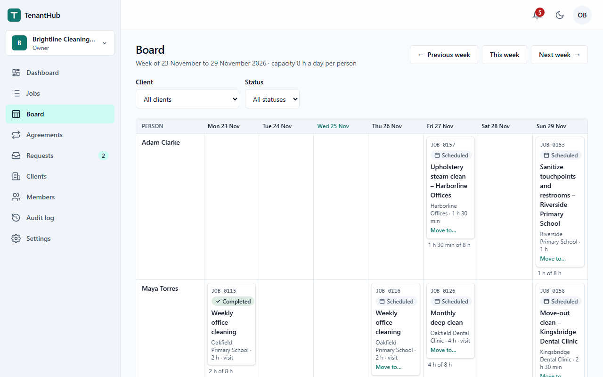 | 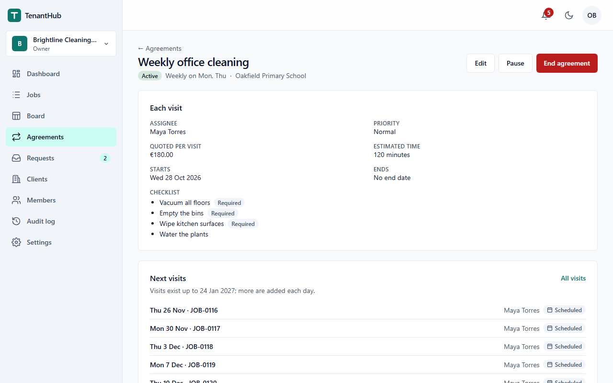 |
| The board: people by days, planned hours against the day's capacity | An agreement: its schedule, the next visits and the ones changed by hand |
| 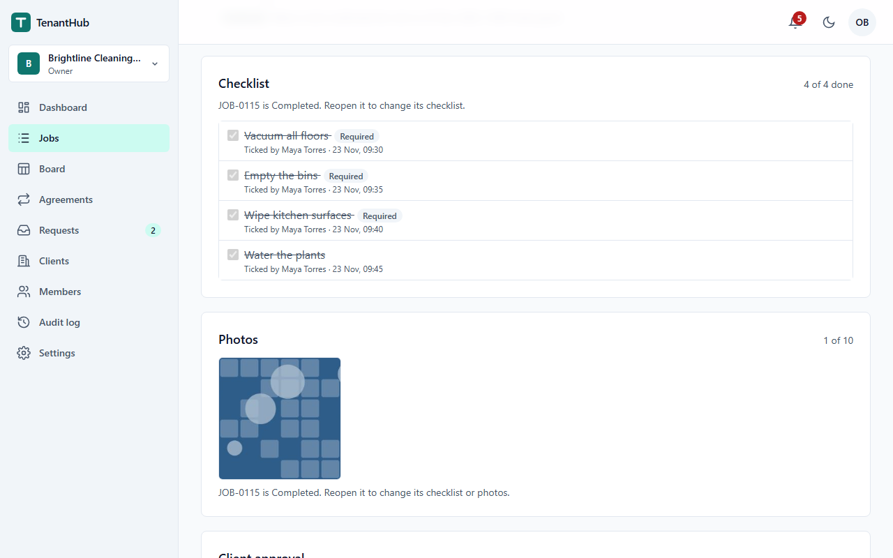 | 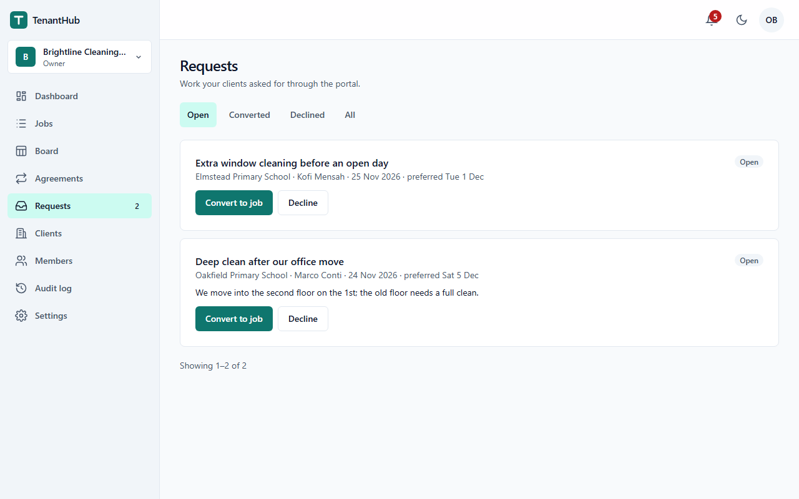 |
| Completion proof: who ticked what, and the photo | Work requests from the portal, converted into jobs or declined |
| 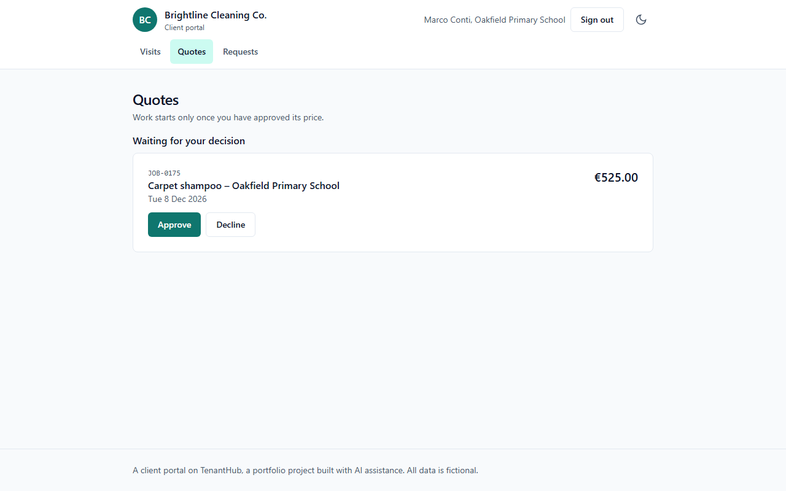 | 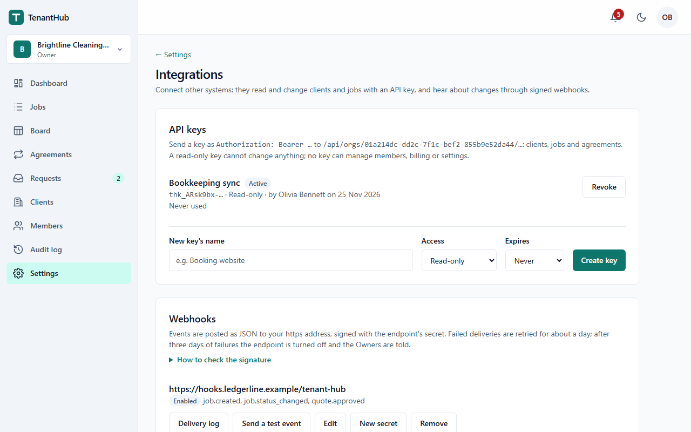 |
| The client portal: a quote waiting for the client's decision | Integrations: API keys and signed webhooks (Business plan) |
| 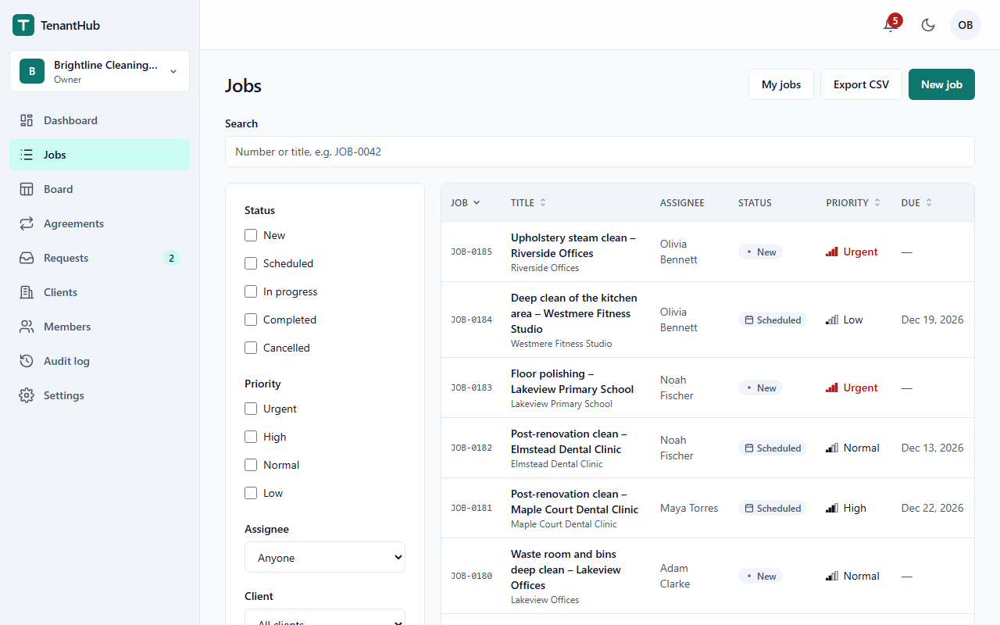 | 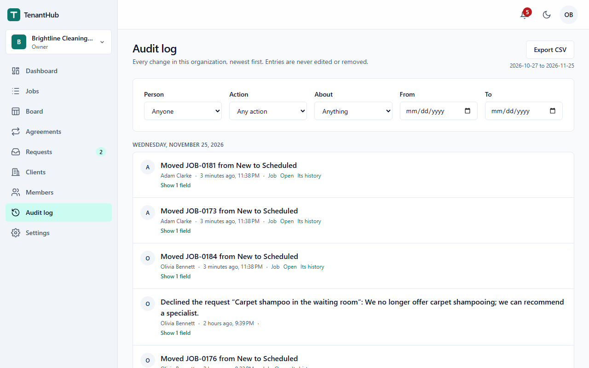 |
| Jobs: search, filters and sort in the URL, and a CSV export | The audit log: who changed what, field by field (a person, a client or a key) |
| 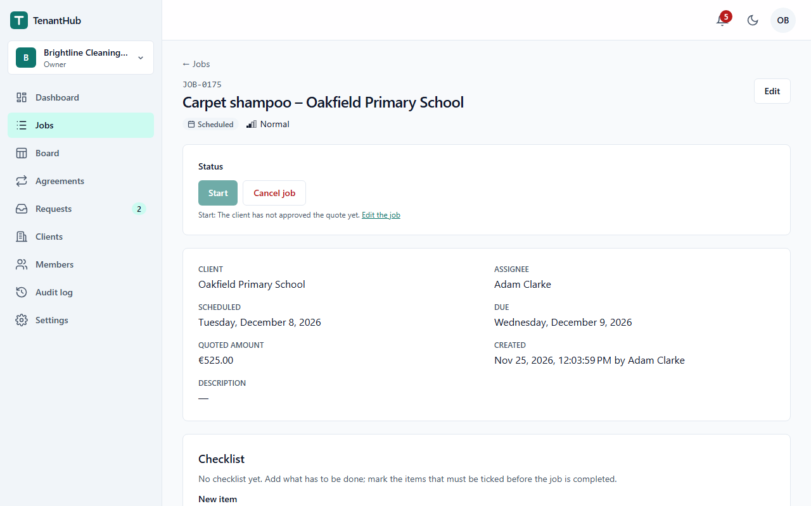 | 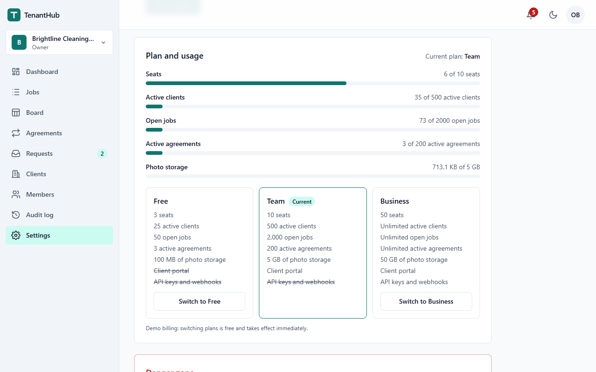 |
| A job: only the moves your role allows, its quote, and its history | Plans: limits enforced on the server, and features by plan |

<p>
  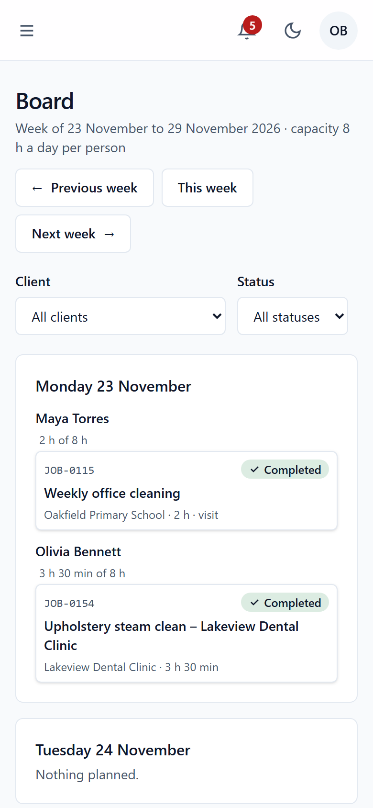
  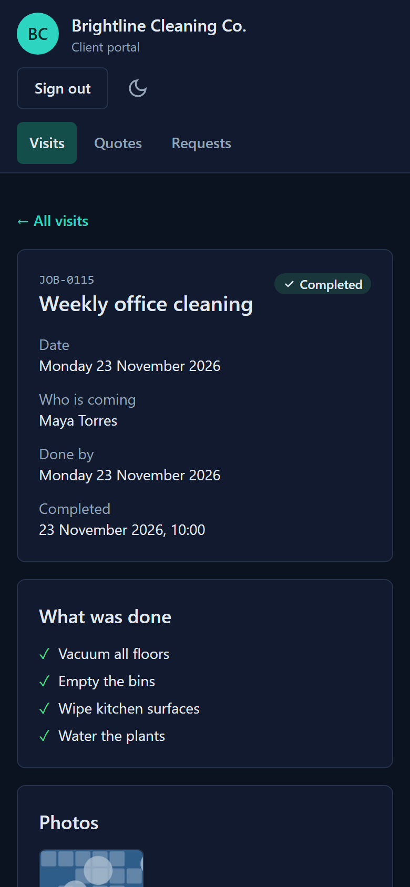
  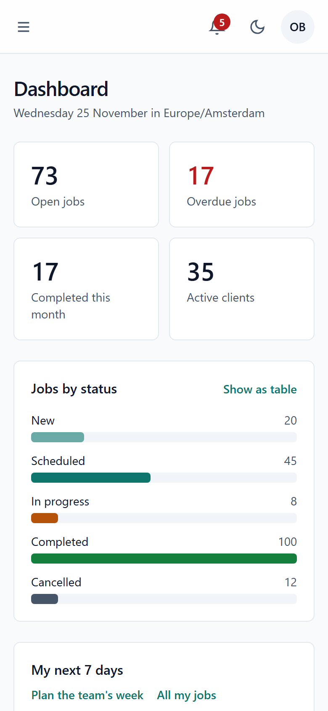
</p>

## How tenant isolation is enforced and proven

All organizations share one PostgreSQL schema, as most SaaS products do, so isolation has to be enforced by the code
and the database together. TenantHub enforces it in six layers, and each layer has tests that fail when it is
weakened:

1. **Every request proves who it is.** The organization comes from the route (`/api/orgs/{orgId}/…`), never from the
   body or a header. A member's active membership is loaded on every request; a portal contact's client and an API
   key are checked the same way. Without one, the answer is `404`, identical for another company's organization, an
   unknown id and a removed member, so nothing is revealed.
2. **Every endpoint declares a permission**, checked on the server (`403` otherwise). Rules about a specific resource,
   such as "a member works only on jobs assigned to them" or "the last Owner cannot leave", live in the domain model.
3. **Every query is filtered** to the current organization by an EF Core query filter on each tenant-owned entity.
4. **Every save is checked:** writing a row of another organization (or another client, from the portal), or moving
   a row between organizations, is refused and logged as a security event.
5. **The database refuses** cross-tenant references: rows point at each other through composite foreign keys that
   include the organization.
6. **The database refuses the rows themselves:** row-level security on every tenant-owned table, and on client-owned
   ones in a portal session. The API connects as its own database user, which cannot bypass the policies.

**The proof** is in the test suite: 881 isolation tests out of 1,728 API tests.
- **Matrices:** for every tenant-scoped endpoint, a user of organization A calls it with organization B's route and
  with B's ids under A's own route; nothing is found, nothing in B changes (row hashes), and nothing of B appears in
  any response. The same is done for every role, for API keys, and for every portal endpoint between two clients.
- **Coverage tests:** they fail the build when a new entity, endpoint or table is not covered, so new features cannot
  forget isolation.
- **Mutation checks:** the suite was checked by breaking the code on purpose. Because the layers overlap, removing the
  application's tenant filter no longer opens anything: the database still refuses the rows. Removing the database's
  policy as well makes the cross-tenant matrix fail, and without the database session settings 817 of 881 isolation
  tests fail: the layer fails closed.

The layers, the tests behind each and the request flow are in [`docs/ARCHITECTURE.md`](docs/ARCHITECTURE.md).

## Features

- **Organizations:** sign up, confirm your email, invite your team, and belong to several organizations with a
  switcher. Password reset by email.
- **Roles:** Owner, Admin, Member and Viewer, enforced on the server. The interface shows only what your role allows.
- **Clients and jobs:** a job workflow (new → scheduled → in progress → completed, or cancelled with a reason), job
  numbers per organization, assignees, estimated durations, and a CSV export. Search, filters, sorting and paging run
  in SQL and live in the URL.
- **Agreements and the board:** recurring visits generated ahead, a week board with drag and drop and a keyboard
  path, and daily capacity per person.
- **The client portal:** visits, quotes for approval, work requests, and sign-off of completed visits with their
  checklist and photos.
- **Notifications:** a bell with unread counts, emails by preference, and a daily digest of overdue jobs at 07:00 in
  the organization's time zone.
- **Integrations:** API keys (read-only or read-write) and HMAC-signed webhooks with retries, a delivery log and
  redelivery.
- **Audit log:** append-only (the database rejects updates), with field-level changes, naming the person, client
  contact, API key or system that acted; a CSV export.
- **Plans and limits:** Free, Team and Business, with limits on seats, clients, open jobs, agreements and photo
  storage, and features by plan. The limits hold under concurrent requests.
- **Dashboard:** figures that link to the matching lists, an accessible chart with a table alternative, your next
  seven days, and plan usage.
- **Demo mode** for a public demo: one-click sign-in per role and as a client, protected demo accounts, a scheduled
  reset, email off and lower rate limits.

## Quality, measured

These numbers come from [`PROGRESS.md`](PROGRESS.md) → Measured results, where each is recorded with its method,
machine and date.

- **Tests:**
  - 1,728 API tests (domain, application, architecture and integration against real PostgreSQL, run as the
    restricted database user), 881 of them the isolation suite, and 254 Angular component tests;
  - two Playwright journeys against the production image, each failing on any console error or CSP violation: sign
    up → invite → accept → complete a job → the audit log; and an agreement → the board by keyboard → the client
    approves the quote → checklist and photo → the client signs off → a signed webhook, verified in the test.
- **Speed:**
  - with row-level security on and 10,000 jobs across 20 organizations, the jobs list API has a p95 of 25.4–26.1 ms
    and the board week 28.4–28.7 ms (target: under 200 ms);
  - Lighthouse (mobile) on the production image: landing page 98, dashboard 88–93 (median 92), board 90, the portal's
    visits 96–98;
  - an initial bundle of 97 kB (estimated transfer); the board, the portal and each feature load on demand.
- **Accessibility:** every v2 screen and overlay audited at 320 to 1280 px and 200 % zoom, in both themes, by keyboard,
  with axe, loading, error and empty states, and a clean console: 368 of 368 checks. Details in
  [`docs/AUDIT.md`](docs/AUDIT.md).
- **Security:**
  - row-level security under a restricted database user;
  - a strict Content-Security-Policy with no inline scripts or styles;
  - `HttpOnly`, `SameSite=Strict` cookies, separate for staff and clients, and antiforgery;
  - rate limits on sign-in, sign-up, invitations, emailed links and API keys;
  - tokens and API keys stored as hashes, shown once;
  - uploads re-encoded without metadata; webhooks only to public addresses, checked at connection time;
  - a non-root container; CI scans the full git history for secrets and audits dependencies.

## Stack

- **Backend:** .NET 10, ASP.NET Core Minimal APIs, EF Core with PostgreSQL 18, ASP.NET Core Identity, SkiaSharp. Four
  projects (Domain, Application, Infrastructure, Api); architecture tests enforce the layering.
- **Frontend:** Angular 22 (standalone, zoneless, signals), NgRx SignalStore, Tailwind CSS v4, Angular CDK.
- **Tests:** xUnit v3, Testcontainers, `WebApplicationFactory`, Vitest, Playwright, axe-core.
- **Delivery:**
  - a multi-stage Dockerfile (Ubuntu chiseled runtime, non-root), and Docker Compose;
  - GitHub Actions: format, lint, all tests, both end-to-end journeys against the image, dependency audits, a secret
    scan and workflow lint;
  - one required check guards every merge.

## Run and test it as a developer

The dev setup runs PostgreSQL and Mailpit in Docker and the API and Angular on the host:

```
cp .env.example .env
docker compose -f docker-compose.dev.yml up -d --wait
dotnet tool restore
dotnet run --project src/api/TenantHub.Api          # API on http://localhost:5090
cd src/web && npm ci && npm start                    # app on http://localhost:4200
```

Tests: `dotnet test --solution TenantHub.slnx` (Docker must run: the integration tests start their own PostgreSQL),
`cd src/web && npm run test:ci`, and both end-to-end journeys with `cd tests/e2e && npm ci && npx playwright test`
against the stack started with `docker compose -f docker-compose.yml -f docker-compose.e2e.yml up --build --wait`.
Connecting another system: [`docs/INTEGRATIONS.md`](docs/INTEGRATIONS.md). Every verified command is in
[`CLAUDE.md`](CLAUDE.md) → Commands.

## Decisions and trade-offs

Every significant choice is in [`DECISIONS.md`](DECISIONS.md), with the alternatives considered. A few that shape the
product:
- **One shared schema** rather than a schema or database per tenant (D005): simple to operate, so isolation must be
  enforced in depth, and since v2 by the database too (D038).
- **The organization in the route**, with membership checked on every request (D006): several tabs can work in
  different organizations, and a removed member loses access immediately.
- **Client contacts are a separate identity** with an emailed sign-in link, their own cookie and their own boundary in
  the database, rather than users with a "client" role (D040).
- **A transactional outbox** for every side effect, so a rolled-back change sends nothing (D039).
- **Webhooks checked at connection time,** not when the address is saved, since DNS can change in between (D044).
- **No mediator, no generic repository** (D003): one handler per command or query, registered directly.
- **No hosted demo** (D035, D053): the free tiers sleep or have no disk, and the owner chose no running cost.

## Limits

- No hosted demo; the demo runs locally with Docker.
- Billing is simulated: switching plans is free and immediate.
- Emails go to the local mail catcher; the demo mode sends none.
- Photos are stored on a local volume, not in object storage.
- Screen readers, Firefox and Safari were not part of the audits.

## How it was built

TenantHub is an independent portfolio project built **with AI assistance** (Claude Code), under my direction:
- I wrote the specification and made the decisions;
- the work went in twenty-three milestones, each a pull request with its own verification report, reviewed and merged
  by me;
- the process is visible in the repository: [`docs/SPEC.md`](docs/SPEC.md) and the milestone briefs in
  [`prompts/`](prompts/), [`PROGRESS.md`](PROGRESS.md), and the PR history.

## Licence

[MIT](LICENSE). All data in the repository is fictional; names of people, companies and places are invented, and email
addresses use the reserved `.example` domain.
