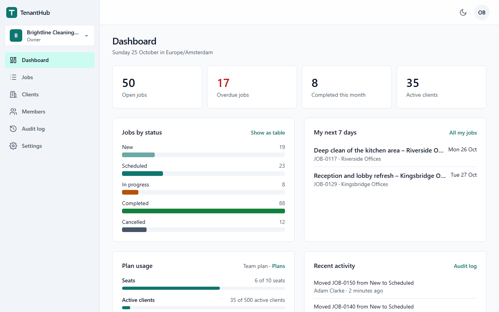
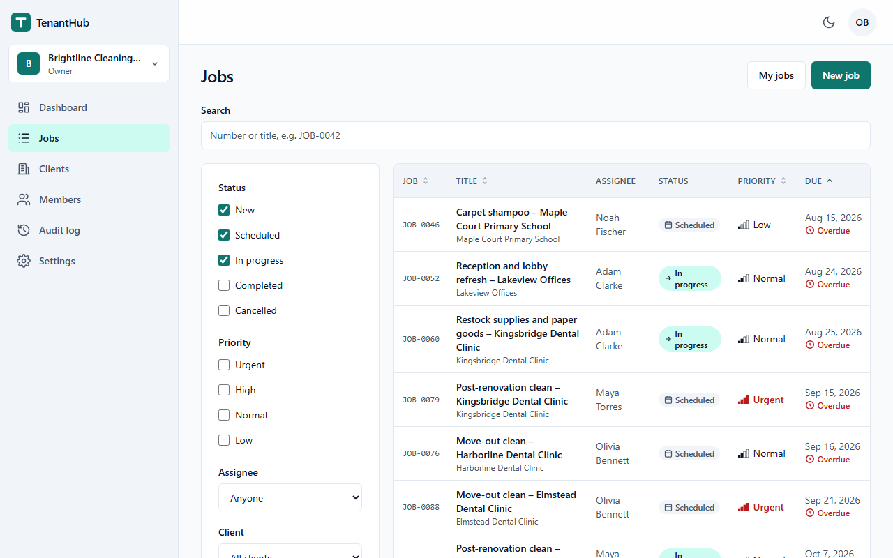
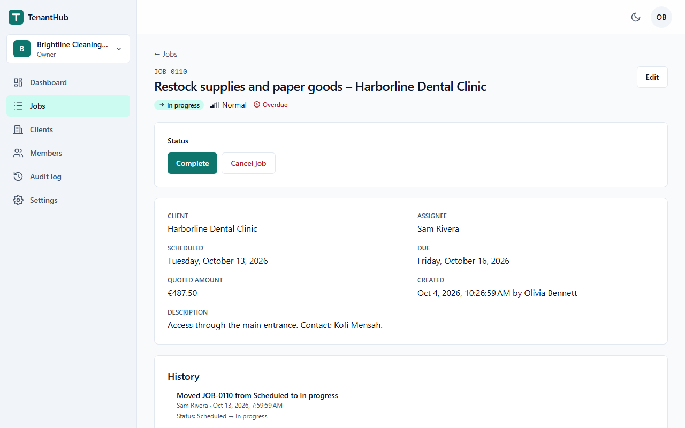
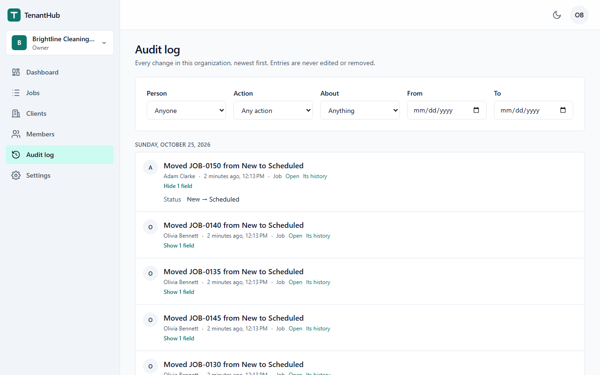
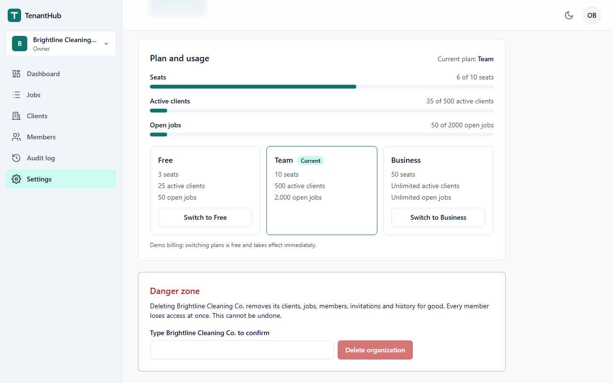
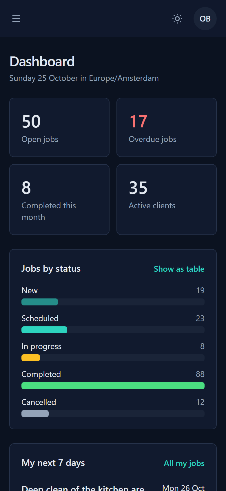
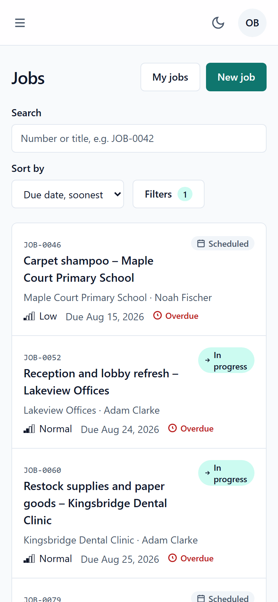

# TenantHub

> A multi-tenant back-office for small service businesses, built on the SaaS foundation most B2B products need:
> isolated tenants, real permissions, invitations, plan limits and an audit trail that cannot be edited.



TenantHub lets a cleaning company, a landscaper or a small agency sign up as an organization, invite its team, keep
its clients, and plan and track jobs. Every change is recorded. The product is deliberately ordinary. What it
demonstrates is the part that is hard to get right and expensive to fix later: **one customer can never see or touch
another customer's data**, and the code proves it with tests that cover new features automatically.

It is a portfolio project. All organizations, people and data in it are fictional.

## Try it

With Docker running, from a fresh clone:

```
cp .env.example .env
docker compose up --build --wait
```

Open http://localhost:8080. On a machine that already had the base images, building and starting took about 50
seconds. The stack is the production image with PostgreSQL and a local mail catcher, and it starts with demo data:
**Brightline Cleaning Co.** (Team plan, 40 clients, 150 jobs over four months) and **Harbor & Pine Landscaping** (Free
plan, at its limits).

Sign in with the `DEMO_PASSWORD` from `.env` (`Change-Me-Demo-2026!` unless you change it) as:

| Who | Role | What they see |
|---|---|---|
| `olivia@brightline.example` | Owner | everything, including the plan and deleting the organization |
| `adam@brightline.example` | Admin | the team, clients, jobs, settings and the audit log |
| `maya@brightline.example` | Member | clients and jobs; works on the jobs assigned to her |
| `victor@brightline.example` | Viewer | reads clients and jobs, changes nothing |
| `sam@tenanthub.example` | Member at Brightline, Admin at Harbor & Pine | one account in two organizations (the switcher) |

Invitation emails land in the local inbox at http://localhost:8026. `docker compose down` stops everything;
`--volumes` also deletes the data.

A recording of a walkthrough is in [`docs/media/walkthrough.webm`](docs/media/walkthrough.webm): sign in, follow the
overdue tile, complete a job, find it in the audit log. There is no public hosted demo yet; the reasons and the
hosting options are in D035.

## Screens

| | |
|---|---|
|  |  |
| Jobs: search, filters and sort in the URL | A job: only the moves your role allows, and its history |
|  |  |
| The audit log: who changed what, field by field | Plan limits, enforced on the server |

<p>
  
  
</p>

## How tenant isolation is enforced and proven

All organizations share one PostgreSQL schema, as most SaaS products do, so isolation has to be enforced by the code
and the database together. TenantHub enforces it in five layers, and each layer has tests that fail when it is
weakened:

1. **Every request proves membership.** The organization comes from the route (`/api/orgs/{orgId}/…`), never from the
   body or a header. The caller's active membership is loaded on every request. Without one, the answer is `404`,
   identical for another company's organization, an unknown id and a removed member, so nothing is revealed.
2. **Every endpoint declares a permission**, checked on the server (`403` otherwise). Rules about a specific resource,
   such as "a member works only on jobs assigned to them" or "the last Owner cannot leave", live in the domain model.
3. **Every query is filtered** to the current organization by an EF Core query filter on each tenant-owned entity.
4. **Every save is checked:** writing a row of another organization, or moving a row between organizations, is
   refused and logged as a security event.
5. **The database refuses** cross-tenant references: jobs point at clients and assignees through composite foreign keys
   that include the organization.

**The proof** is in the test suite: 301 tenant-isolation tests out of 748 API tests.
- **Cross-tenant matrix:** for every tenant-scoped endpoint, a user of organization A calls it with organization B's
  route and with B's ids under A's own route. The test checks that nothing is found, nothing in B changes (row
  hashes), and nothing of B appears in any response.
- **Coverage tests:** they fail the build when a new entity or endpoint is not covered, so new features cannot forget
  isolation.
- **Mutation checks:** the suite was checked by breaking the code on purpose. Disabling the query filter makes 58
  integration tests fail; making the membership check ignore the caller makes 139 fail.

The layers, the tests behind each and the request flow are in [`docs/ARCHITECTURE.md`](docs/ARCHITECTURE.md).

## Features

- **Organizations:** sign up, invite your team by email, and belong to several organizations with a switcher.
- **Roles:** Owner, Admin, Member and Viewer, enforced on the server. The interface shows only what your role allows.
- **Clients and jobs:** a job workflow (new → scheduled → in progress → completed, or cancelled with a reason), job
  numbers per organization, and assignees. Search, filters, sorting and paging all run in SQL and live in the URL.
- **Audit log:** append-only (the database rejects updates), with field-level changes. Filter by person, action, date
  or item, with keyset paging.
- **Plans and limits:** Free, Team and Business limits on seats, active clients and open jobs. The limits hold under
  concurrent requests, and a downgrade is refused while usage exceeds the target plan.
- **Dashboard:** figures that link to the matching lists, an accessible chart with a table alternative, your next
  seven days, and plan usage.
- **Demo mode** for a public demo: one-click sign-in per role, protected demo accounts, a scheduled reset, email off
  and lower rate limits.

## Quality, measured

These numbers come from [`PROGRESS.md`](PROGRESS.md) → Measured results, where each is recorded with its method,
machine and date.

- **Tests:**
  - 748 API tests (domain, application, architecture and integration against real PostgreSQL) and 136 Angular
    component tests;
  - one Playwright journey against the production image: sign up, invite, accept from the email, plan and complete
    a job, find it in the audit log.
- **Speed:**
  - the jobs list API has a p95 of 17.2–17.9 ms with 10,000 jobs across 20 organizations (target: under 200 ms);
  - Lighthouse (mobile) on the production image scores 98 on the landing page and 95–96 on the dashboard.
- **Accessibility:** 0 axe violations of any impact on all 20 screens in both themes. Keyboard support, visible focus,
  reduced motion and contrast are checked (WCAG 2.2 AA target); the details are in
  [`docs/AUDIT.md`](docs/AUDIT.md).
- **Security:**
  - a strict Content-Security-Policy with no inline scripts;
  - `HttpOnly`, `SameSite=Strict` cookies and antiforgery;
  - rate-limited sign-in, sign-up and invitations;
  - invitation tokens stored as hashes;
  - a non-root container;
  - CI scans the full git history for secrets and audits dependencies.

## Stack

- **Backend:** .NET 10, ASP.NET Core Minimal APIs, EF Core with PostgreSQL 18, ASP.NET Core Identity. Four projects
  (Domain, Application, Infrastructure, Api); architecture tests enforce the layering.
- **Frontend:** Angular 22 (standalone, zoneless, signals), NgRx SignalStore, Tailwind CSS v4, Angular CDK.
- **Tests:** xUnit v3, Testcontainers, `WebApplicationFactory`, Vitest, Playwright, axe-core.
- **Delivery:**
  - a multi-stage Dockerfile (Ubuntu chiseled runtime, non-root), and Docker Compose;
  - GitHub Actions: format, lint, all tests, the end-to-end journey against the image, dependency audits, a secret
    scan and workflow lint;
  - one required check guards every merge.

## Run and test it as a developer

The dev setup runs PostgreSQL and Mailpit in Docker and the API and Angular on the host:

```
cp .env.example .env
docker compose -f docker-compose.dev.yml up -d --wait
dotnet tool restore
dotnet run --project src/api/TenantHub.Api          # API on http://localhost:5090
cd src/web && npm ci && npm start                    # app on http://localhost:4200
```

Tests: `dotnet test --solution TenantHub.slnx` (Docker must run: the integration tests start their own PostgreSQL),
`cd src/web && npm run test:ci`, and the end-to-end journey with `cd tests/e2e && npm ci && npx playwright test`
against the composed stack. Every verified command is in [`CLAUDE.md`](CLAUDE.md) → Commands.

## Decisions and trade-offs

Every significant choice is in [`DECISIONS.md`](DECISIONS.md), with the alternatives considered. A few that shape the
product:
- **One shared schema** rather than a schema or database per tenant (D005): simple to operate, so isolation must be
  enforced in depth.
- **The organization in the route**, with membership checked on every request (D006): several tabs can work in
  different organizations, and a removed member loses access immediately.
- **No mediator, no generic repository** (D003): one handler per command or query, registered directly.
- **Audit entries in the same transaction as the change**, and append-only in the database (D012, D030).
- **No public demo yet** (D035): the free hosting tiers either sleep for about a minute or need a payment method.

## How it was built

TenantHub is an independent portfolio project built **with AI assistance** (Claude Code), under my direction:
- I wrote the specification and made the decisions;
- the work went in twelve milestones, each a pull request with its own verification report, reviewed and merged by me;
- the process is visible in the repository: [`docs/SPEC.md`](docs/SPEC.md) and the milestone briefs in
  [`prompts/`](prompts/), [`PROGRESS.md`](PROGRESS.md), and the PR history.

## Licence

[MIT](LICENSE). All data in the repository is fictional; names of people, companies and places are invented, and email
addresses use the reserved `.example` domain.
