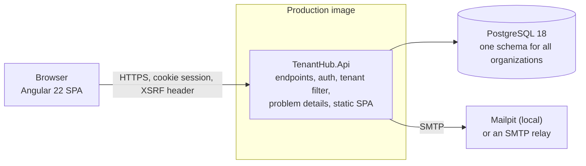
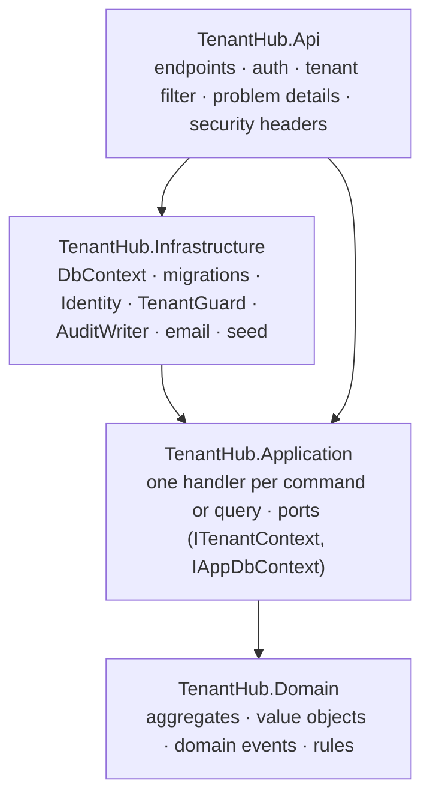
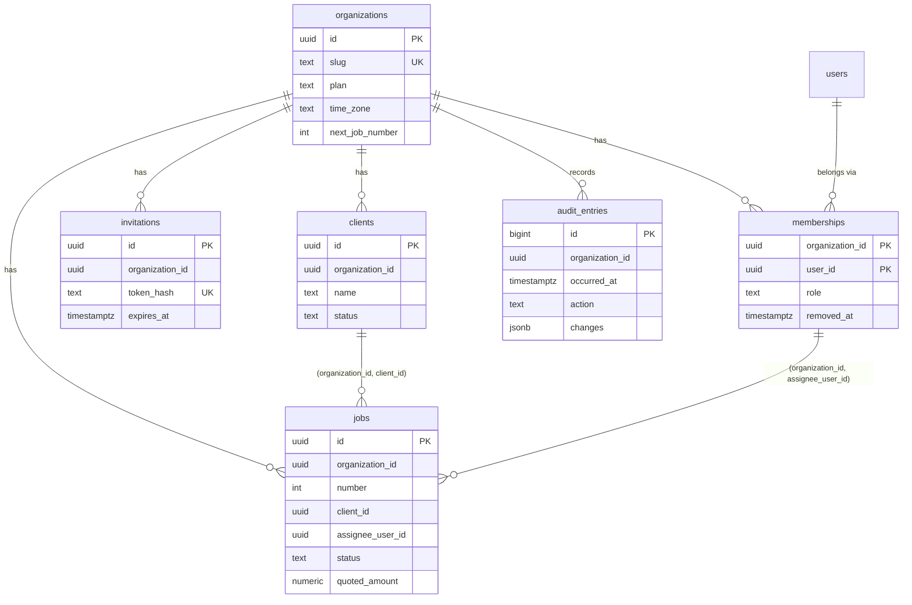

# Architecture

How TenantHub is built, as of v1.0. The reasons behind each choice are in [`DECISIONS.md`](../DECISIONS.md); measured
numbers are in [`PROGRESS.md`](../PROGRESS.md) → Measured results.

## The pieces

One ASP.NET Core application (.NET 10, Minimal APIs) serves the JSON API and the Angular single-page app, in front of
one PostgreSQL database. The production image runs as a non-root user on Ubuntu chiseled; `docker-compose.yml` adds
PostgreSQL and Mailpit (D034).



### Projects and their dependencies

The backend has four projects (D003). The arrows are the only references allowed; `LayerDependencyTests` fails the
build on any other.



- **Domain** has no framework dependencies. It holds the job workflow, the last-Owner and role-grant rules, plan
  policy, and the domain events that become audit entries.
- **Application** has a handler per command or query (`JobCommands`, `ListJobsQuery`, `DashboardQuery`…), registered
  directly, with no mediator and no generic repository.
- **Infrastructure** implements the ports with EF Core and Npgsql.
- **Api** keeps endpoints thin: bind, declare the permission, call a handler.

The SPA (`src/web`) is Angular 22: standalone components, zoneless, signals, NgRx SignalStore and Tailwind CSS v4. It
never re-implements the role map; it shows only what the permissions from `GET /api/auth/session` allow (D008).

## A tenant-scoped command, end to end

Every tenant-scoped route has the form `/api/orgs/{orgId}/...`. The organization comes from the route and the caller's
membership, never from the body, a header or a claim (D006). As an example, here is Maya completing a job:
`POST /api/orgs/{orgId}/jobs/{id}/transitions { "to": "completed" }`.

```mermaid
sequenceDiagram
  autonumber
  participant B as Browser
  participant P as Pipeline<br/>(antiforgery, auth, rate limits)
  participant F as TenantResolutionFilter
  participant H as JobCommands
  participant D as Job (domain)
  participant G as TenantGuard + AuditWriter
  participant DB as PostgreSQL
  B->>P: POST with session cookie + X-XSRF-TOKEN
  P->>F: authenticated user
  F->>DB: open one connection for the request; caller's own active membership in {orgId} (app.user_id)
  alt no active membership
    F-->>B: 404 organization-not-found (same as an unknown id)
  else membership lacks jobs.work / jobs.manage
    F-->>B: 403 permission-denied
  end
  F->>H: TenantContext (organization, user, role, permissions)
  H->>DB: load job (query filter adds organization_id = current; the policy checks app.organization_id)
  H->>D: TransitionTo(completed, actor, …)
  D-->>H: rule checks (workflow table, assignee may work it), JobStatusChanged event
  H->>G: SaveChanges
  G->>G: every tenant-owned row belongs to the current organization? else refuse and log
  G->>DB: UPDATE job + INSERT audit entry, one transaction
  DB-->>B: 200 with the job view
```

Steps that need a consistent view of the whole organization take a row lock on the organization first:
- plan limits;
- the last-Owner rule;
- job numbering.

The lock is `FOR NO KEY UPDATE`, so it serializes those commands without blocking foreign-key checks (D033).

## Data model

One schema; every tenant-owned table carries `organization_id`.



- **Users** are global (ASP.NET Core Identity): one person can belong to several organizations. `data_protection_keys`
  (the cookie-signing keys, D033) is the only other global table. Global tables have no row-level security; every
  tenant-owned one has (layer 6).
- **Jobs** reference clients and assignees through **composite foreign keys** that include `organization_id`, so the
  database itself refuses a job pointing at another organization's client or member.
- **Audit entries** are append-only: a trigger rejects `UPDATE` (D030). They go away only with their organization.
- **Deleting an organization** cascades to every tenant-owned row.

## Tenant isolation: layers and their proof

Isolation is enforced in six layers. Each layer has tests that fail when it is weakened, and the coverage tests make
new code join the suite automatically: an unclassified entity or endpoint, or a tenant-owned table without its policy,
fails the build.

| Layer | What it does | Proven by |
|---|---|---|
| 1. Membership per request | `TenantResolutionFilter` loads the caller's active membership for `{orgId}`; none → `404`, identical for foreign, unknown and removed (D006) | `CrossTenantMatrixTests`: every tenant endpoint called with another organization's route and with its resource ids under our own route; nothing found, nothing changed (row hash), nothing leaked |
| 2. Permissions | every tenant endpoint declares one; missing → `403`. Resource rules (assigned jobs, Owner rules) are in the domain | `PermissionMatrixTests` (every endpoint × every role), domain unit tests |
| 3. Query filters | a named filter `organization_id = current` on every `ITenantOwned` entity | `ModelCoverageTests`: every tenant-owned entity has the filter, an index starting with `organization_id`, and a cascading key to its organization; every other entity is on a reviewed list |
| 4. Save guard | `TenantGuard` stamps new rows and refuses any write to another organization's row, or a change of `organization_id`; logged as a security event | `TenantGuardTests` |
| 5. Database | composite foreign keys including `organization_id` | `JobEndpointTests.The_database_refuses_a_job_that_points_at_another_organizations_client_or_member` (raw SQL, past every application check) |
| 6. Row-level security | PostgreSQL policies on every tenant-owned table: a row is visible and writable only if its `organization_id` equals the session's `app.organization_id`. The API connects as its own user, which cannot bypass them (M14, D038) | `RowSecurityTests` (coverage of every tenant-owned table; raw SQL as the API's user; a pooled connection reused across tenants), `DatabaseRoleTests` (startup refuses a user that could bypass) |
| Bypasses | `AcrossTenants()` (the only `IgnoreQueryFilters` call) is allowed in a short list of named files, each with its reason. In the database, the same files may widen reading in two narrow ways (`RowSecurity.ReadAsUser`, `PresentInvitationToken`), and one reviewed `SECURITY DEFINER` function answers the demo reset's question | `TenantBypassAllowListTests`, `RowSecurityTests.The_only_way_past_the_policies_is_the_reviewed_definer_function` |
| Every endpoint | classified as public, user-scoped or tenant-scoped; each tenant endpoint has a matrix case, and each state change writes an audit entry | `EndpointCoverageTests`, `AuditCoverageTests` |

**Mutation checks.** The suite was checked by breaking the code on purpose (M03, repeated on the full application in
M10):
- with the tenant filter disabled, 58 integration tests fail;
- with the membership check ignoring the caller, 139 fail;
- an unclassified endpoint fails the classification test, and a tenant endpoint without a case fails the case test.

Since M14 the layers overlap on purpose:
- with the query filter on `Job` removed, the cross-tenant matrix still passes, because the database refuses the rows;
- with the jobs policy removed as well, the matrix fails on five job endpoints;
- without the session settings, 415 of 485 integration tests fail; the cross-tenant matrix fails because PostgreSQL refuses the writes that set it up, so the layer fails closed.

Results are in `PROGRESS.md` → Measured results.

### Row-level security (layer 6)
- **Two database users.** Migrations run as the schema owner (`ConnectionStrings:DatabaseAdmin`), which is exempt from
  the policies as table owner. The API connects as its own user (`ConnectionStrings:Database`), created at startup
  from that connection string, with data access only. At startup the API refuses to run as a superuser, a
  `BYPASSRLS` role or a table owner, since any of them would skip every policy.
- **The settings.** `RowSecurityInterceptor` gives the database session three values before EF Core runs a command,
  whenever they differ from what that connection last received: the entered organization, the user whose memberships
  the scope reads, and the hash of a presented invitation token. Opening or closing a connection, or a rollback, makes
  it set them again. Unset values are empty and match no row.
- **One connection per tenant request.** `TenantResolutionFilter` opens the connection before resolving the tenant, so
  the request's queries share it and the settings go out about once, not once per query.
- **Policies.** `tenant_isolation` on every tenant-owned table, for every command. For `SELECT` only, two more:
  `own_memberships` (a user's memberships in every organization, for the session, tenant resolution and the
  five-owned limit) and `presented_invitation` (the one invitation whose token the request holds). The demo reset asks
  the `SECURITY DEFINER` function `user_has_tenant_references` whether any organization still refers to a visitor
  account; it answers yes or no for one user.
- **Cost.** The planner folds the policy into the query's own filter (a one-time filter), and a query with no filter
  uses the policy as its index condition. The measured cost is in the extra round trip (`PROGRESS.md`).

## Cross-cutting

- **Authentication:**
  - ASP.NET Core Identity with an `HttpOnly`, `SameSite=Strict` session cookie, `Secure` outside development;
  - antiforgery on every unsafe request;
  - rate limits on sign-up, sign-in, invitations and account emails;
  - lockout after repeated failures;
  - password reset and email verification by emailed link (30 minutes and 7 days, single use through the security
    stamp; D039). Verification is asked only while email is on, and inviting needs it.
- **Errors:** RFC 7807 problem details with a `traceId`, and a stable `code` for business-rule errors.
- **Security headers:** a strict CSP with no inline scripts or styles (the SPA has no component styles, D023), HSTS in
  production, `nosniff`, a referrer policy, a permissions policy and `frame-ancestors 'none'`.
- **Time:** an injected `TimeProvider`; timestamps in UTC; "today" and "this month" in the organization's time zone.
- **Concurrency:** optimistic concurrency (`xmin`) on organizations, clients and jobs; row locks for the rules that need
  a whole-organization view.
- **Invitations:** 32-byte random tokens, stored as SHA-256 hashes, compared in constant time, single use. The token
  travels in the URL fragment, so it never reaches server logs (D028).
- **Background work** (D039):
  - side effects that leave the request (account emails now; notifications and webhooks later) are rows in
    `outbox_messages`, written by the same `SaveChanges` as the change, so a rolled-back command sends nothing;
  - a dispatcher on every instance claims due rows with `FOR UPDATE SKIP LOCKED` and a lease, retries with backoff
    (dead after six attempts) and deletes a secret payload once it is delivered;
  - recurring work (outbox retention, the demo reset) is a row in `scheduled_tasks` with a due time and a lease, so a
    restart neither skips nor repeats a run, and a host that slept runs a task once on waking.
- **Demo mode** (`DEMO_MODE=true`):
  - one-click sign-in per role;
  - protections for the shared accounts;
  - a reset, on the scheduler, that also removes visitors' organizations and accounts after a day;
  - email off and lower rate limits (D032, D033).

## Testing

| Suite | What | Where |
|---|---|---|
| Domain and application unit tests | rules, workflow, plan policy | `tests/TenantHub.Domain.Tests`, `tests/TenantHub.Application.Tests` |
| Architecture tests | layering, the bypass allow-list | `tests/TenantHub.ArchitectureTests` |
| Integration tests | the real API (`WebApplicationFactory`) against PostgreSQL in Testcontainers, the isolation suite included | `tests/TenantHub.IntegrationTests` |
| Component tests | Angular pages and stores (Vitest) | `src/web/**/*.spec.ts` |
| End-to-end | the main journey and a cross-tenant check through the UI, against the production image | `tests/e2e` (Playwright) |

Every pull request runs all of them in CI, plus format, lint, dependency audits, a full-history secret scan and
workflow lint. One required check, **CI result**, gates the merge ([`docs/CI.md`](CI.md)).
