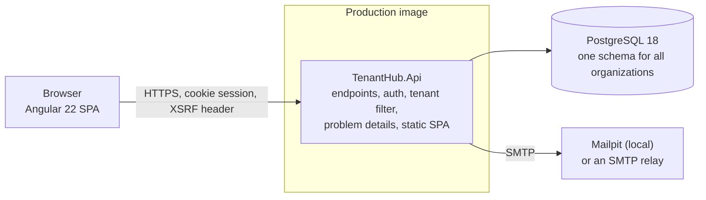
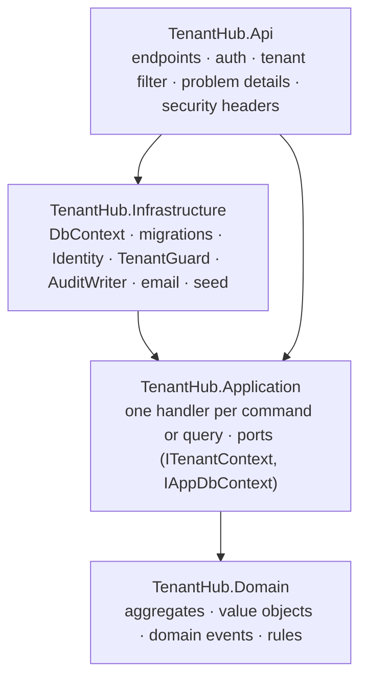
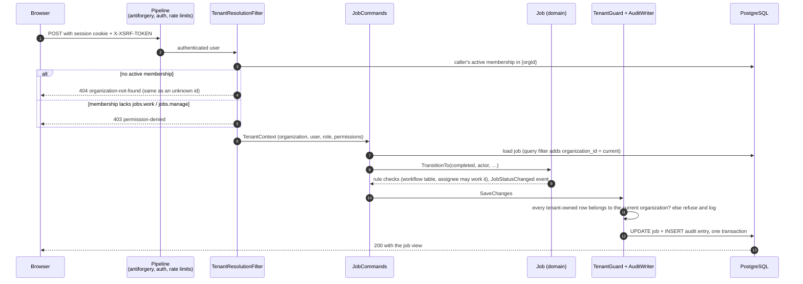
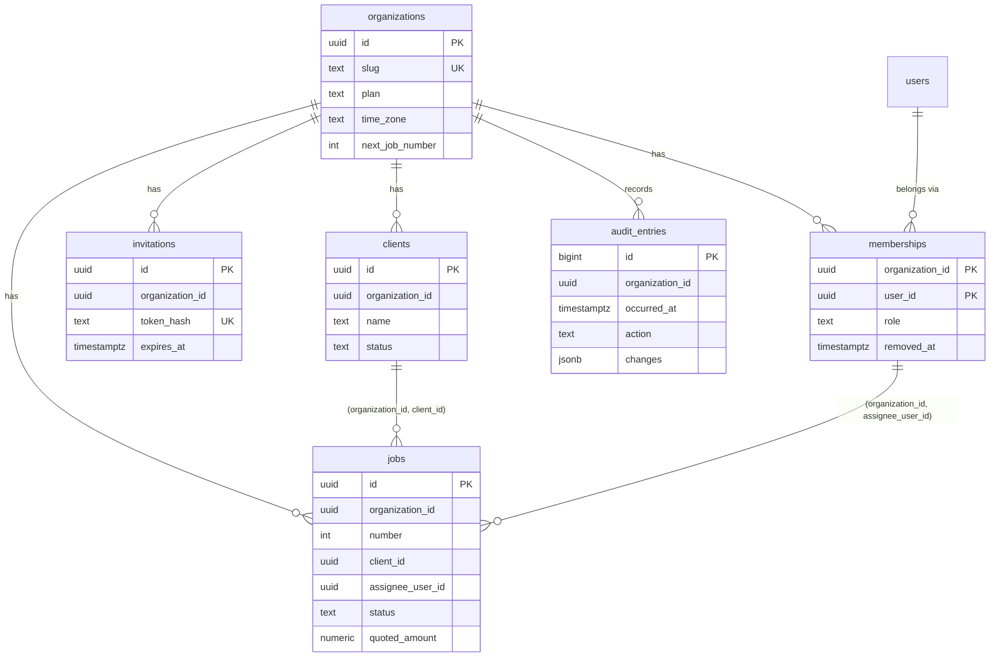

# Architecture

How TenantHub is built, as of v1.0. The reasons behind each choice are in [`DECISIONS.md`](../DECISIONS.md); measured
numbers are in [`PROGRESS.md`](../PROGRESS.md) → Measured results.

## The pieces

One ASP.NET Core application (.NET 10, Minimal APIs) serves the JSON API and the Angular single-page app, in front of
one PostgreSQL database. The production image runs as a non-root user on Ubuntu chiseled; `docker-compose.yml` adds
PostgreSQL and Mailpit (D034).

### Projects and their dependencies

The backend has four projects (D003). The arrows are the only references allowed; `LayerDependencyTests` fails the
build on any other.

- **Domain** has no framework dependencies. It holds the job workflow, the last-Owner and role-grant rules, plan
  policy, and the domain events that become audit entries.
- **Application** has a handler per command or query (`JobCommands`, `ListJobsQuery`, `DashboardQuery`…), registered
  directly, with no mediator and no generic repository.
- **Infrastructure** implements the ports with EF Core and Npgsql.
- **Api** keeps endpoints thin: bind, declare the permission, call a handler.

The SPA (`src/web`) is Angular 22: standalone components, zoneless, signals, NgRx SignalStore and Tailwind CSS v4. It
never re-implements the role map; it shows only what the permissions from `GET /api/auth/session` allow (D008).

## A tenant-scoped command, end to end

Every tenant-scoped route has the form `/api/orgs/{orgId}/...`. The organization comes from the route and the caller's
membership, never from the body, a header or a claim (D006). As an example, here is Maya completing a job:
`POST /api/orgs/{orgId}/jobs/{id}/transitions { "to": "completed" }`.

Steps that need a consistent view of the whole organization take a row lock on the organization first:
- plan limits;
- the last-Owner rule;
- job numbering.

The lock is `FOR NO KEY UPDATE`, so it serializes those commands without blocking foreign-key checks (D033).

## Data model

One schema; every tenant-owned table carries `organization_id`.

- **Users** are global (ASP.NET Core Identity): one person can belong to several organizations. `data_protection_keys`
  (the cookie-signing keys, D033) is the only other global table.
- **Jobs** reference clients and assignees through **composite foreign keys** that include `organization_id`, so the
  database itself refuses a job pointing at another organization's client or member.
- **Audit entries** are append-only: a trigger rejects `UPDATE` (D030). They go away only with their organization.
- **Deleting an organization** cascades to every tenant-owned row.

## Tenant isolation: layers and their proof

Isolation is enforced in five layers. Each layer has tests that fail when it is weakened, and the coverage tests make
new code join the suite automatically: an unclassified entity or endpoint fails the build.

| Layer | What it does | Proven by |
|---|---|---|
| 1. Membership per request | `TenantResolutionFilter` loads the caller's active membership for `{orgId}`; none → `404`, identical for foreign, unknown and removed (D006) | `CrossTenantMatrixTests`: every tenant endpoint called with another organization's route and with its resource ids under our own route; nothing found, nothing changed (row hash), nothing leaked |
| 2. Permissions | every tenant endpoint declares one; missing → `403`. Resource rules (assigned jobs, Owner rules) are in the domain | `PermissionMatrixTests` (every endpoint × every role), domain unit tests |
| 3. Query filters | a named filter `organization_id = current` on every `ITenantOwned` entity | `ModelCoverageTests`: every tenant-owned entity has the filter, an index starting with `organization_id`, and a cascading key to its organization; every other entity is on a reviewed list |
| 4. Save guard | `TenantGuard` stamps new rows and refuses any write to another organization's row, or a change of `organization_id`; logged as a security event | `TenantGuardTests` |
| 5. Database | composite foreign keys including `organization_id` | `JobEndpointTests.The_database_refuses_a_job_that_points_at_another_organizations_client_or_member` (raw SQL, past every application check) |
| Bypasses | `AcrossTenants()` (the only `IgnoreQueryFilters` call) is allowed in a short list of named files, each with its reason | `TenantBypassAllowListTests` |
| Every endpoint | classified as public, user-scoped or tenant-scoped; each tenant endpoint has a matrix case, and each state change writes an audit entry | `EndpointCoverageTests`, `AuditCoverageTests` |

**Mutation checks.** The suite was checked by breaking the code on purpose (M03, repeated on the full application in
M10):
- with the tenant filter disabled, 58 integration tests fail;
- with the membership check ignoring the caller, 139 fail;
- an unclassified endpoint fails the classification test, and a tenant endpoint without a case fails the case test.

Results are in `PROGRESS.md` → Measured results.

## Cross-cutting

- **Authentication:**
  - ASP.NET Core Identity with an `HttpOnly`, `SameSite=Strict` session cookie, `Secure` outside development;
  - antiforgery on every unsafe request;
  - rate limits on sign-up, sign-in and invitations;
  - lockout after repeated failures.
- **Errors:** RFC 7807 problem details with a `traceId`, and a stable `code` for business-rule errors.
- **Security headers:** a strict CSP with no inline scripts or styles (the SPA has no component styles, D023), HSTS in
  production, `nosniff`, a referrer policy, a permissions policy and `frame-ancestors 'none'`.
- **Time:** an injected `TimeProvider`; timestamps in UTC; "today" and "this month" in the organization's time zone.
- **Concurrency:** optimistic concurrency (`xmin`) on organizations, clients and jobs; row locks for the rules that need
  a whole-organization view.
- **Invitations:** 32-byte random tokens, stored as SHA-256 hashes, compared in constant time, single use. The token
  travels in the URL fragment, so it never reaches server logs (D028).
- **Demo mode** (`DEMO_MODE=true`):
  - one-click sign-in per role;
  - protections for the shared accounts;
  - a scheduled reset that also removes visitors' organizations and accounts after a day;
  - email off and lower rate limits (D032, D033).

## Testing

| Suite | What | Where |
|---|---|---|
| Domain and application unit tests | rules, workflow, plan policy | `tests/TenantHub.Domain.Tests`, `tests/TenantHub.Application.Tests` |
| Architecture tests | layering, the bypass allow-list | `tests/TenantHub.ArchitectureTests` |
| Integration tests | the real API (`WebApplicationFactory`) against PostgreSQL in Testcontainers, the isolation suite included | `tests/TenantHub.IntegrationTests` |
| Component tests | Angular pages and stores (Vitest) | `src/web/**/*.spec.ts` |
| End-to-end | the main journey and a cross-tenant check through the UI, against the production image | `tests/e2e` (Playwright) |

Every pull request runs all of them in CI, plus format, lint, dependency audits, a full-history secret scan and
workflow lint. One required check, **CI result**, gates the merge ([`docs/CI.md`](CI.md)).
