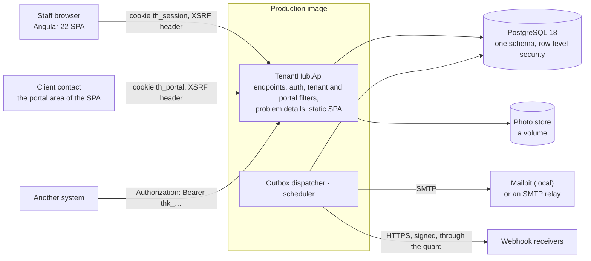
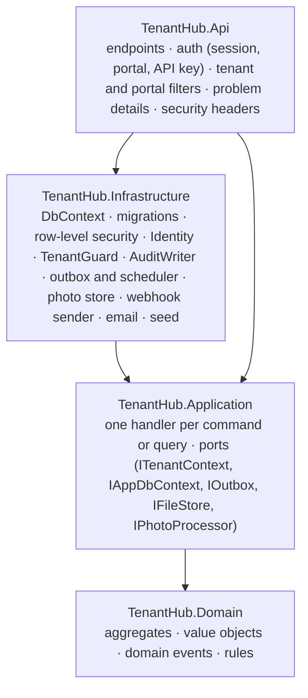
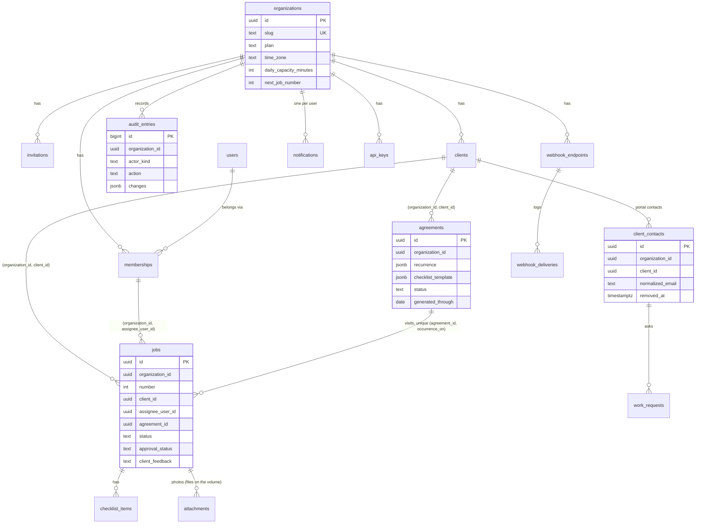

# Architecture

How TenantHub is built, as of v2.0. The reasons behind each choice are in [`DECISIONS.md`](../DECISIONS.md); the
product rules are in [`SPEC.md`](SPEC.md); measured numbers are in [`PROGRESS.md`](../PROGRESS.md) → Measured results.

## The pieces

One ASP.NET Core application (.NET 10, Minimal APIs) serves the JSON API and the Angular single-page app, in front of
one PostgreSQL database and a directory of photos. The same process runs the outbox dispatcher and the scheduler. The
production image runs as a non-root user on Ubuntu chiseled; `docker-compose.yml` adds PostgreSQL and Mailpit (D034).



### Projects and their dependencies

The backend has four projects (D003). The arrows are the only references allowed; `LayerDependencyTests` fails the
build on any other.



- **Domain** has no framework dependencies. It holds the job workflow (with its quote and checklist conditions), the
  last-Owner and role-grant rules, plan policy and features, recurrence, API keys and webhook endpoints, and the
  domain events that become audit entries, notifications and webhook events.
- **Application** has a handler per command or query (`JobCommands`, `ListJobsQuery`, `BoardQuery`, `PortalVisits`…),
  registered directly, with no mediator and no generic repository.
- **Infrastructure** implements the ports with EF Core and Npgsql, SkiaSharp and the file system.
- **Api** keeps endpoints thin: bind, declare the permission, call a handler.

The SPA (`src/web`) is Angular 22: standalone components, zoneless, signals, NgRx SignalStore and Tailwind CSS v4. It
never re-implements the role map; it shows only what the permissions from `GET /api/auth/session` allow (D008), and
asks for a plan feature only when the organization's plan has it. The portal is a lazy-loaded area of the same app,
with its own layout and session store.

## A tenant-scoped command, end to end

Every tenant-scoped route has the form `/api/orgs/{orgId}/...`. The organization comes from the route and the caller's
membership, never from the body, a header or a claim (D006). As an example, here is Maya completing a job:
`POST /api/orgs/{orgId}/jobs/{id}/transitions { "to": "completed" }`.

```mermaid
sequenceDiagram
  autonumber
  participant B as Browser
  participant P as Pipeline<br/>(API key check, antiforgery, auth, rate limits)
  participant F as TenantResolutionFilter
  participant H as JobCommands
  participant D as Job (domain)
  participant G as TenantGuard + AuditWriter
  participant DB as PostgreSQL
  B->>P: POST with session cookie + X-XSRF-TOKEN
  P->>F: authenticated user
  F->>DB: open one connection for the request; caller's own active membership in {orgId} (app.user_id)
  alt no active membership
    F-->>B: 404 organization-not-found (same as an unknown id)
  else membership lacks jobs.work / jobs.manage
    F-->>B: 403 permission-denied
  end
  F->>H: TenantContext (organization, user, role, permissions)
  H->>DB: load job and its checklist (query filter adds organization_id = current; the policy checks app.organization_id)
  H->>D: TransitionTo(completed, actor, …)
  D-->>H: rule checks (workflow table, required items done, assignee may work it), JobStatusChanged event
  H->>G: SaveChanges
  G->>G: every tenant-owned row belongs to the current organization? else refuse and log
  G->>DB: UPDATE job + INSERT audit entry + INSERT outbox messages (webhook fan-out), one transaction
  DB-->>B: 200 with the job view
```

Steps that need a consistent view of the whole organization take a row lock on the organization first: plan limits
(storage and active agreements included), the last-Owner rule, job numbering and visit generation. The lock is
`FOR NO KEY UPDATE`, so it serializes those commands without blocking foreign-key checks (D033). A job's checklist and
its transitions take the job's row lock, and webhook endpoint edits and deliveries take the endpoint's.

**The same command from a portal contact or an API key** goes through the same handler, entered differently:
- a **portal** request (`/api/portal/...`) passes `PortalResolutionFilter`, which checks on every request that the
  contact and the client are active and the plan has the portal, and enters the organization *as the contact*
  (`TenantContext.EnterAsContact`): no user, no staff permissions, and `app.client_id` set for the database (D040);
- a request with **an API key** is recognized by `ApiKeyMiddleware` before authorization. The endpoint must allow keys;
  the key is found by its hash inside the route's organization, through the filter and the policies, and the request
  runs with the key's fixed permissions (D044). A key with a cookie is refused, and antiforgery is skipped (there is
  no cookie to forge).

## Data model

One schema; every tenant-owned table carries `organization_id`, a query filter, an index starting with it, and
row-level security. The full column lists are in [`SPEC.md`](SPEC.md) 8.1.



- **Users** are global (ASP.NET Core Identity): one person can belong to several organizations. Also global, by the
  owner's approval: `notification_preferences` (per user), `outbox_messages` and `scheduled_tasks` (infrastructure that
  only the workers read), and `data_protection_keys` (the key ring, D033). Global tables have no row-level security;
  every tenant-owned one has (layer 6).
- **Composite foreign keys** include `organization_id`, so the database itself refuses a job pointing at another
  organization's client, member or agreement, and likewise for contacts, checklist items and photos.
- **Audit entries** are append-only: a trigger rejects `UPDATE` (D030). They go away only with their organization.
- **Deleting an organization** cascades to every tenant-owned row; its photo folder is removed through the outbox, and a
  weekly sweep removes any file that no row names.

## Tenant isolation: layers and their proof

Isolation is enforced in six layers. Each layer has tests that fail when it is weakened, and the coverage tests make
new code join the suite automatically: an unclassified entity or endpoint, a tenant endpoint without a matrix case, or
a tenant-owned table without its policy fails the build.

| Layer | What it does | Proven by |
|---|---|---|
| 1. Who is asking | `TenantResolutionFilter` loads the caller's active membership for `{orgId}`; none → `404`, identical for foreign, unknown and removed (D006). Contacts pass `PortalResolutionFilter`; keys are found inside the route's organization | `CrossTenantMatrixTests` (every tenant endpoint with another organization's route and with its ids under our own; nothing found, nothing changed by row hash, nothing leaked), `PortalMatrixTests`, `ApiKeyMatrixTests` |
| 2. Permissions | every tenant endpoint declares one; missing → `403`. Resource rules (assigned jobs, Owner rules) are in the domain. Keys have fixed permission sets; contacts have none | `PermissionMatrixTests` (every endpoint × every role), `ApiKeyMatrixTests`, domain unit tests |
| 3. Query filters | a named filter `organization_id = current` on every `ITenantOwned` entity; portal handlers also name the session's client | `ModelCoverageTests`: every tenant-owned entity has the filter, an index starting with `organization_id`, and a cascading key to its organization; every other entity is on a reviewed list |
| 4. Save guard | `TenantGuard` stamps new rows and refuses any write to another organization's row (or another client's, in a portal session), or a change of `organization_id`; logged as a security event | `TenantGuardTests`, `PortalScopeTests` |
| 5. Database keys | composite foreign keys including `organization_id` | raw-SQL tests past every application check |
| 6. Row-level security | PostgreSQL policies on every tenant-owned table: a row is visible and writable only if its `organization_id` equals the session's `app.organization_id`, and in a portal session only if it belongs to `app.client_id`. The API connects as its own user, which cannot bypass them (D038, D040) | `RowSecurityTests` (coverage of every tenant-owned and client-owned table; raw SQL as the API's user; a pooled connection reused across tenants), `DatabaseRoleTests` (startup refuses a user that could bypass) |
| Bypasses | `AcrossTenants()` (the only `IgnoreQueryFilters` call) is allowed in four named files, each with its reason; v2 added none. In the database, the same files may widen reading in two narrow ways, and one reviewed `SECURITY DEFINER` function answers the demo reset's question | `TenantBypassAllowListTests`, `RowSecurityTests` (the pinned list of definer functions) |
| Every endpoint | classified as public, user-scoped, tenant-scoped or portal-scoped; each tenant endpoint has a matrix case; each state change writes an audit entry; a key works only where the endpoint allows it | `EndpointCoverageTests`, `AuditCoverageTests`, `ApiKeyMatrixTests` |

**Mutation checks.** The suite was checked by breaking the code on purpose (M03, M10, M14, M18 and M22; details in
`PROGRESS.md` → Measured results). What M22 found on the finished v2:
- the tenant filter matching every row: 6 of 881 isolation tests fail (58 did in v1) and the cross-tenant matrix
  holds, because the policies refuse the rows; with the jobs policy removed as well, the matrix fails on job endpoints;
- the membership check ignoring the caller: nothing fails, because the database's `own_memberships` policy still
  limits the lookup to the caller; with that policy widened too, 596 fail;
- without the session settings, 817 of 881 fail: the layer fails closed;
- portal handlers without their client filter: the client policies keep the portal matrix green; with the policies
  made permissive too, 10 portal tests fail; without `PortalResolutionFilter`, 37 fail;
- API keys accepted everywhere, read-only keys writing, revoked keys working: 66, 5 and 13 failures; the key lookup
  bypassing the filter: the matrix holds (row-level security) and the allow-list test fails.

### Row-level security (layer 6)
- **Two database users.** Migrations run as the schema owner (`ConnectionStrings:DatabaseAdmin`), which is exempt from
  the policies as table owner. The API connects as its own user (`ConnectionStrings:Database`), created at startup
  from that connection string, with data access only. At startup the API refuses to run as a superuser, a
  `BYPASSRLS` role or a table owner, since any of them would skip every policy.
- **The settings.** `RowSecurityInterceptor` gives the database session four values before EF Core runs a command,
  whenever they differ from what that connection last received: the entered organization, the user whose memberships
  the scope reads, the hash of a presented invitation token, and in a portal session the client. Opening or closing a
  connection, or a rollback, makes it set them again. Unset values are empty and match no row.
- **One connection per tenant request.** The resolution filters open the connection before resolving, so the
  request's queries share it and the settings go out about once, not once per query.
- **Policies.** `tenant_isolation` on every tenant-owned table, for every command. A restrictive `client_isolation` on
  clients, jobs, agreements, contacts and work requests, and through the job on checklist items and photos, which
  narrows every other policy when `app.client_id` is set and is inert in staff sessions. For `SELECT` only, two more:
  `own_memberships` (a user's memberships in every organization) and `presented_invitation` (the one invitation whose
  token the request holds). The demo reset asks the `SECURITY DEFINER` function `user_has_tenant_references` whether
  any organization still refers to a visitor account; it answers yes or no for one user.
- **Cost.** The planner folds the policy into the query's own filter, and a query with no filter uses the policy as
  its index condition. The measured cost is in the extra round trip (`PROGRESS.md`).

## Background work: the outbox and the scheduler (D039)

- **Outbox.** Side effects that leave the request are rows in `outbox_messages`, written by the same `SaveChanges` as
  the change and its audit entries, so a rolled-back command sends nothing: account and portal emails, notifications
  (fanned out from audited changes, D050), webhook events (fanned out per endpoint, D044) and file clean-up.
  Invitations keep their v1 contract and are sent during the request (D011).
- **Dispatcher.** A loop on every instance claims due rows with `FOR UPDATE SKIP LOCKED` and a five-minute lease, so
  two instances never deliver one message twice. A failure retries after 1, 5 and 15 minutes, 1 and 4 hours, and the
  message is dead after the sixth attempt; a type may carry its own schedule (webhooks: eight attempts over about a
  day). Payloads that carry a secret (a reset or sign-in link) are encrypted with Data Protection and deleted once
  delivered.
- **Scheduler.** Recurring work is a row in `scheduled_tasks` with a due time and a lease, so a restart neither skips
  nor repeats a run, two instances never run one task at once, and a host that slept runs it once on waking:
  `agreements.generate` and `notifications.digest` per organization (in its time zone), `outbox.retention`,
  `files.sweep` (weekly), and `demo.reset` in demo mode.
- **Tests** run two dispatchers and two schedulers against one database and drive them with a moving clock.

## Features with architecture of their own

- **Agreements** (D041): repeating work for a client generates ordinary jobs ("visits") up to 60 days ahead, in the
  command that creates or changes the agreement and daily per organization, under the organization lock and unique on
  `(organization_id, agreement_id, occurrence_on)`. `Recurrence` is a domain value object over dates in the
  organization's zone. Visits are audited as "System (agreement …)" (`actor_kind`).
- **The board** (D046): one query returns the week's cards, the "Not scheduled" queue and each cell's planned minutes.
  A move is a command with the job's concurrency token; a day after the due date answers `409 after-due-date` until
  the move confirms. The page draws only the layout the screen needs: the people-by-days grid with CDK drag and drop
  from 1024 px, a day-by-day list below; "Move to…" works by keyboard in both, and every move is announced.
- **Photos** (D043): the upload is recognized by its magic bytes, the codec must agree, and the dimensions are checked
  from the header (at most 12,000 px a side, 50 megapixels for JPEG, 25 for the others) before anything is decoded;
  at most two decode at once. SkiaSharp decodes to sRGB, shrinks the long edge to 2,560 px, re-encodes without any
  metadata and makes a thumbnail. Files live under a random key in the organization's folder of `Files__Root`, served
  only through authorized endpoints with `nosniff`, `Content-Disposition` and a private cache.
- **Webhooks** (D044): `WebhookTriggers` in the audit writer map the catalog's events onto domain events and write a
  fan-out message in the same save. Each delivery signs `t=<unix>,v1=<HMAC-SHA256>` (both secrets during a rotation)
  and records the attempt under the endpoint's row lock. `GuardedWebhookSender` is one `HttpClient` whose
  `ConnectCallback` resolves the host itself, refuses it if any address is not public unicast (IPv4 inside IPv6 judged
  as IPv4), and connects to the address it checked: no second lookup, no redirects, no proxy, ten seconds. One named
  local receiver is allowed only in Development and in the E2E environment of the second journey (D052).
- **Exports** (D051): CSV with a byte-order mark and neutralized cells, streamed from `AsAsyncEnumerable` to the
  response, so 50,000 audit entries take under half a megabyte of heap.
- **Notifications** (D050): fanned out from audited changes through the outbox to the people concerned (never the
  actor, never a former member), shown under the bell and emailed according to each user's preferences; the 07:00
  digest runs per organization; kept for 90 days.

## Cross-cutting

- **Authentication:**
  - ASP.NET Core Identity with an `HttpOnly`, `SameSite=Strict` session cookie, `Secure` outside development;
  - the portal: its own cookie scheme (`th_portal`, scoped to `/api/portal`), signed in by a one-time emailed link;
  - API keys: `thk_` and 32 random bytes, stored as a SHA-256 hash with a short prefix, shown once;
  - antiforgery on every unsafe cookie request; rate limits on sign-up, sign-in, invitations, account emails, portal
    links and per API key; lockout after repeated failures;
  - password reset and email verification by emailed link (30 minutes and 7 days, single use through the security
    stamp; D039). Verification is asked only while email is on, and inviting needs it.
- **Errors:** RFC 7807 problem details with a `traceId`, and a stable `code` for business-rule errors.
- **Security headers:** a strict CSP with no inline scripts or styles (the SPA has no component styles, D023; the CDK's
  drag styles live in `styles.css`), HSTS in production, `nosniff`, a referrer policy, a permissions policy and
  `frame-ancestors 'none'`.
- **Time:** an injected `TimeProvider`; timestamps in UTC; "today", "this month", the board's week, visit dates and the
  digest's hour in the organization's time zone.
- **Concurrency:** optimistic concurrency (`xmin`) on organizations, clients, jobs and agreements; row locks for the
  rules that need a whole-organization view, a job's checklist, and a webhook endpoint.
- **Tokens in links** (invitations, portal sign-in, reset, verification) travel in the URL fragment, so they never
  reach server logs (D028).
- **Plan features** (D042): every feature endpoint checks the plan (`403 plan-feature-unavailable`); so do portal
  sessions on every request and webhook delivery. A downgrade lists the features it would turn off and needs
  confirming.
- **Demo mode** (`DEMO_MODE=true`):
  - one-click sign-in per role, and "Try as a client" for the seeded contacts;
  - protections for the shared accounts;
  - a reset, on the scheduler, that re-seeds the demo (photos included), clears the demo accounts' email preferences,
    and removes visitors' organizations and accounts after a day;
  - email off and lower rate limits (D032, D033).

## Testing

| Suite | What | Where |
|---|---|---|
| Domain and application unit tests | rules, workflow, recurrence, plan policy and features, keys and webhooks | `tests/TenantHub.Domain.Tests`, `tests/TenantHub.Application.Tests` |
| Architecture tests | layering, the bypass allow-list | `tests/TenantHub.ArchitectureTests` |
| Integration tests | the real API (`WebApplicationFactory`) against PostgreSQL in Testcontainers, run as the restricted database user; the isolation suite (881 tests, with the portal and API-key matrices) included; webhooks against a real local receiver with a fake resolver; the demo-reset fingerprint | `tests/TenantHub.IntegrationTests` |
| Component tests | Angular pages and stores (Vitest) | `src/web/**/*.spec.ts` |
| End-to-end | two journeys against the production image in its E2E environment (D052): sign-up to the audit log, and an agreement to a signed webhook; both fail on a console error or a CSP violation | `tests/e2e` (Playwright) |

Every pull request runs all of them in CI, plus format, lint, dependency audits, a full-history secret scan and
workflow lint. One required check, **CI result**, gates the merge ([`docs/CI.md`](CI.md)).
